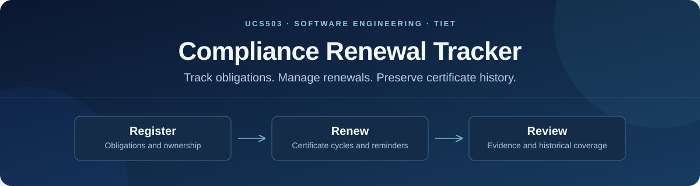
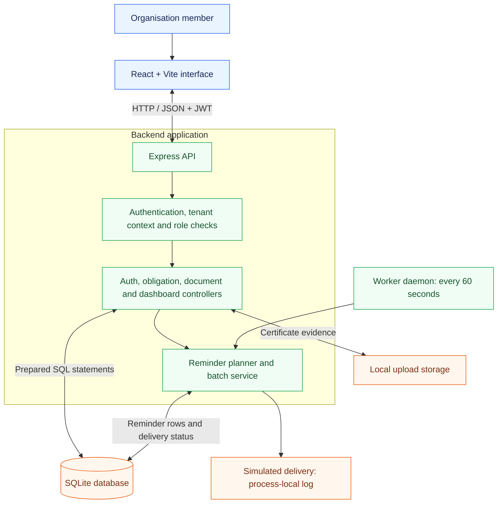
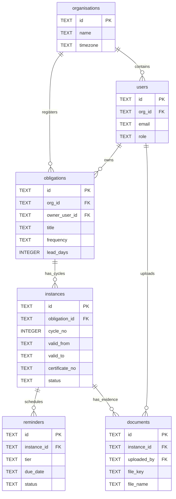

<p align="center">
  
</p>

<p align="center">
  
  
  
  
  
</p>

<p align="center">
  <a href="#overview">Overview</a> ·
  <a href="#architecture">Architecture</a> ·
  <a href="#data-model">Data model</a> ·
  <a href="#quick-start">Quick start</a> ·
  <a href="#project-report">Project report</a> ·
  <a href="#contributing">Contributing</a>
</p>

## Overview

**Compliance Renewal Tracker** is a web application for managing recurring licences, certificates and regulatory approvals. It brings ownership, certificate validity, supporting documents and renewal reminders into one place.

Each obligation has its own sequence of renewal cycles. Adding a new certificate retains the earlier certificate's dates and number, making it possible to answer both **“What needs attention now?”** and **“Which certificate covered this date?”**

Built as a **UCS503 Software Engineering project** at **Thapar Institute of Engineering and Technology, Patiala**.

## Features

| Capability | What the application provides |
| --- | --- |
| **Obligation register** | Record the issuing authority, category, recurrence, warning lead time and responsible owner. Search and filter the register. |
| **Renewal history** | Keep successive certificate cycles with validity dates, certificate numbers and attached evidence. |
| **Historical coverage** | Query a selected date to find a matching certificate period or identify a coverage gap. |
| **Compliance dashboard** | View green, amber and red attention states, summary counts and an expiry timeline. |
| **Owner task view** | See the signed-in owner's latest cycles and their pending reminders. |
| **Tiered reminders** | Plan reminders 30 days before expiry, seven days before expiry and on the expiry date. |
| **Certificate uploads** | Attach PDF, PNG or JPEG evidence to a specific cycle, up to 10 MiB per file. |
| **Access control** | JWT authentication, organisation-scoped obligation/document queries and role checks for creation and deletion. |

The interface uses a gothic visual theme: “decrees” are obligations, “wardens” are owners, and “epochs” are renewal cycles.

## Architecture

The frontend handles presentation and session state. Express exposes the API, SQLite stores the records, and a separate worker processes due reminder rows.



During development, Vite proxies `/api` and `/uploads` to the backend on port `5000`. The API can also trigger a reminder batch on demand through the worker control modal.

### Renewal workflow

1. An administrator or manager registers an obligation and assigns an owner.
2. The application creates the initial certificate cycle and its three reminder tiers.
3. Members review the dashboard, upload evidence or inspect historical coverage.
4. Renewal marks the previous cycle as `renewed` and inserts the next cycle with new dates and reminders.
5. The worker processes due `pending` reminders and stores their resulting status.

## Data model

Six related tables separate the organisation, standing obligation, certificate cycles and supporting records. Selected fields are shown below; the complete runtime schema is in [`backend/src/db/database.js`](backend/src/db/database.js).



The database enforces `UNIQUE(instance_id, tier)` to prevent duplicate reminder planning. Renewal retains prior dates and certificate details, while updating the previous cycle's status. Administrators can delete obligations and their linked records, so the ledger is not a tamper-proof archive.

## Quick start

**Prerequisites:** Git, npm and Node.js 24. The project was run with Node.js `v24.19.0`; the backend uses the built-in `node:sqlite` module.

### 1. Clone and install

```bash
git clone https://github.com/Mr-Oggy-bot/compliance-renewal-tracker.git
cd compliance-renewal-tracker

npm ci --prefix backend
npm ci --prefix frontend
npm --prefix backend run migrate
```

### 2. Optional: load the demo dataset

On a fresh local database, run:

```bash
npm run seed
```

**The seed script replaces existing database records.** It creates two sample organisations, four users and example renewal histories. Use it for a fresh demonstration database.

### 3. Start the application

Run these commands from the project root in separate terminals:

| Terminal | Command | Service |
| --- | --- | --- |
| 1 | `npm run dev:backend` | Express API at `http://localhost:5000` |
| 2 | `npm run dev:frontend` | Web interface at `http://localhost:5173` |
| 3, optional | `npm run worker` | Reminder daemon, polling every 60 seconds |

Open **[http://localhost:5173](http://localhost:5173)**. The backend health endpoint is **[http://localhost:5000/health](http://localhost:5000/health)**.

On Windows, `run-backend.bat` and `run-frontend.bat` are also available after dependency installation. The worker can be started with `npm run worker` or triggered manually from the interface.

### Demo accounts

After seeding, all sample accounts use the password **`Password123!`**.

| Organisation | Role | Email |
| --- | --- | --- |
| Apex Healthcare | Administrator | `admin@apexhealth.org` |
| Apex Healthcare | Manager | `manager@apexhealth.org` |
| Apex Healthcare | Owner | `facility@apexhealth.org` |
| Meridian Manufacturing | Administrator | `admin@meridianmfg.com` |

### Configuration

Optional overrides can be placed in `backend/.env`, which is excluded from Git:

```dotenv
PORT=5000
JWT_SECRET=replace-with-a-long-random-value
REFRESH_SECRET=replace-with-another-long-random-value
```

| Variable | Purpose | Default |
| --- | --- | --- |
| `PORT` | Backend HTTP port | `5000` |
| `JWT_SECRET` | Access-token signing key | Built-in development value |
| `REFRESH_SECRET` | Refresh-token signing key | Built-in development value |
| `DB_PATH` | SQLite database file | `backend/compliance.db` |
| `UPLOAD_DIR` | Certificate storage directory | `uploads/` in the project root |

## Tests and build

```bash
# Existing backend test suite
npm test

# Production frontend bundle
npm run build --prefix frontend
```

The six existing tests cover scoped record lookup, cycle creation, reminder uniqueness, retained renewal history, the supplied worker interruption/restart simulation and historical coverage queries. Tests create fixtures in the configured database; set a separate `DB_PATH` when an isolated test database is needed.

## Implementation notes

| Area | Current behaviour |
| --- | --- |
| **Notifications** | Email delivery is simulated in memory. Reminder status persists in SQLite; the delivery log is local to each process. No SMTP provider is connected. |
| **Worker recovery** | The supplied test interrupts processing after a completed send. External delivery, competing workers and crashes between dispatch and persistence require a stronger delivery design. |
| **Date handling** | Reminder tiers use fixed 30/7/0-day offsets. `lead_days` separately controls the dashboard warning window. |
| **Deployment** | SQLite is the implemented database. PostgreSQL schema and Redis/Compose configuration are included as scaffolding; the adapter and container build setup are incomplete. Use the local setup above. |

This is an academic prototype. The [project report](report/compliance-renewal-tracker-report.pdf) documents the remaining transaction, access-control and deployment limitations.

## Project structure

```text
compliance-renewal-tracker/
├── backend/
│   ├── src/
│   │   ├── config/          # Runtime configuration
│   │   ├── controllers/     # Authentication, ledger, documents and dashboard
│   │   ├── db/              # SQLite schema, migration, seed and SQL reference
│   │   ├── middleware/      # JWT, tenant context, roles and uploads
│   │   ├── routes/          # REST endpoint definitions
│   │   ├── services/        # Reminder planning, batches and worker daemon
│   │   └── server.js
│   └── tests/               # Existing backend tests
├── frontend/
│   ├── public/assets/       # Interface artwork
│   └── src/
│       ├── api/             # HTTP client
│       ├── components/      # Shared UI and modal forms
│       ├── context/         # Authentication state
│       └── pages/           # Login, dashboard, register and owner tasks
├── docs/                    # Earlier project documentation and README assets
├── report/                  # Complete university report and editable diagrams
├── uploads/                 # Runtime certificate files; contents ignored by Git
└── docker-compose.yml       # Deployment scaffolding
```

## Project report

The university lab report follows the supplied TIET template and includes nine technical diagrams.

| Resource | Link |
| --- | --- |
| Complete report | [Read the PDF](report/compliance-renewal-tracker-report.pdf) |
| Overleaf package | [Download the ZIP](report/compliance-renewal-tracker-overleaf.zip) |
| Editable report | [LaTeX main document](report/main.tex) |
| Technical diagrams | [TikZ diagram sources](report/diagrams/) |
| Submission details | [Student and guide placeholders](report/metadata.tex) |

Upload the ZIP to Overleaf, select `main.tex` as the main document and replace the identity placeholders before submission.

## Contributing

Contributions can improve validation, date handling, reminder delivery, tests and the interface.

1. Create a branch for a focused change. External contributors can fork the repository first.
2. Describe the behaviour being changed and keep related code and documentation together.
3. Run the relevant backend tests and frontend build.
4. Open a pull request against `main` with a brief description and verification results.

See [open issues](https://github.com/Mr-Oggy-bot/compliance-renewal-tracker/issues) and [pull requests](https://github.com/Mr-Oggy-bot/compliance-renewal-tracker/pulls) for project discussion.
