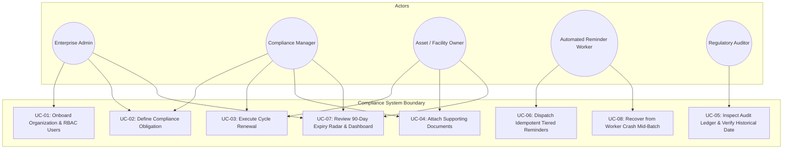
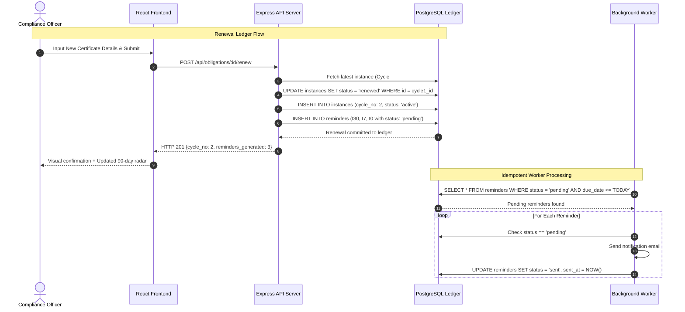
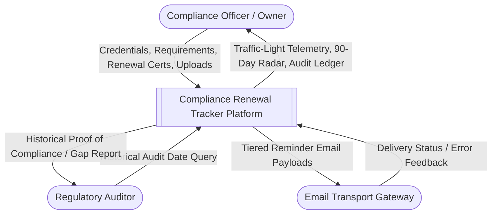
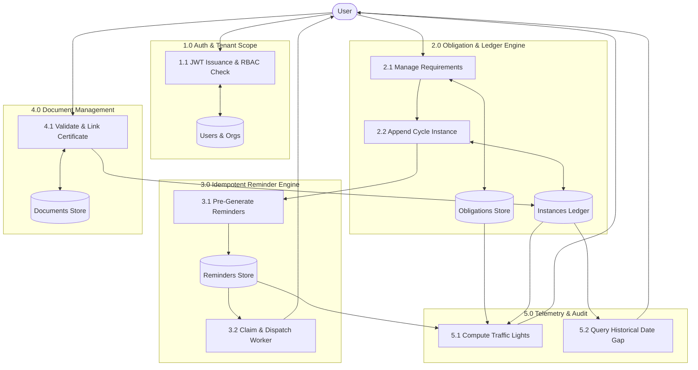
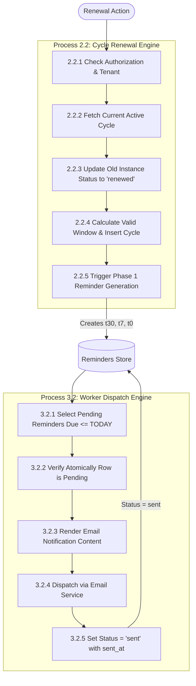
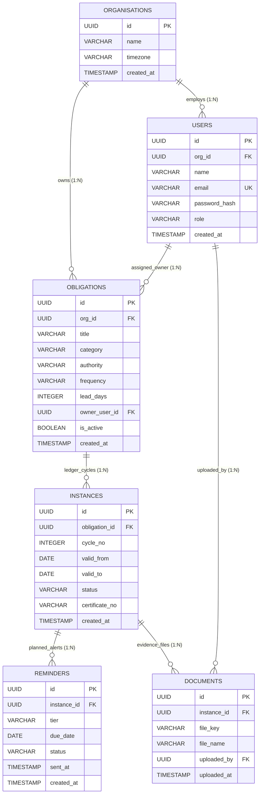

# UCS 503 - SOFTWARE ENGINEERING LAB PROJECT REPORT
## MID-SEMESTER EVALUATION

---

### TITLE OF PROJECT:
# COMPLIANCE RENEWAL TRACKER
### An Append-Only Ledger Web Platform with Idempotent Tiered Notification Delivery

---

**Submitted by:**
- `(102203001)` Student Name 1
- `(102203002)` Student Name 2
- `(102203003)` Student Name 3
- `(102203004)` Student Name 4

**Degree / Branch:** BE Third Year, Computer Science & Engineering (CSE / CoE)  
**Group No:** G-14  

**Submitted to:**  
Faculty Mentor / Course Coordinator  
Computer Science and Engineering Department  
**Thapar Institute of Engineering and Technology (TIET), Patiala - 147004**  

---

## TABLE OF CONTENTS

| S.No. | Assignment / Chapter | Page No. |
|---|---|---|
| **1.** | **Project Selection Phase** | 3 |
| 1.1 | Software Bid | 3 |
| 1.2 | Project Overview | 5 |
| **2.** | **Analysis Phase** | 8 |
| 2.1 | Use Cases | 8 |
| 2.1.1 | Use-Case Diagrams | 8 |
| 2.1.2 | Use Case Templates | 10 |
| 2.2 | Activity Diagram and Swimlane Diagrams | 14 |
| 2.3 | Data Flow Diagrams (DFDs) | 16 |
| 2.3.1 | DFD Level 0 (Context Diagram) | 16 |
| 2.3.2 | DFD Level 1 (Decomposition into Modules) | 17 |
| 2.3.3 | DFD Level 2 (Renewal & Worker Subsystems) | 18 |
| 2.4 | Software Requirement Specification (SRS) in IEEE Format | 20 |
| 2.5 | User Stories and Story Cards | 26 |
| **3.** | **Database Architecture & Entity-Relationship Model** | 29 |
| 3.1 | Entity-Relationship (ER) Diagram & Cardinality | 29 |
| 3.2 | Database Schema & Integrity Constraints | 30 |
| **4.** | **Verification, Test Results & Viva Voce Defense** | 33 |
| 4.1 | Automated Test Case Table & Results | 33 |
| 4.2 | Viva Voce Preparation & Core Architectural Defense | 35 |
| 4.3 | Limitations and Future Scope | 37 |

---

# 1. Project Selection Phase

## 1.1 Software Bid

### 1.1.1 Project Title and Domain
- **Title**: Compliance Renewal Tracker
- **Domain**: Governance, Risk, and Compliance (GRC) / Enterprise Resource Planning (ERP)
- **Primary Stakeholders**: Regulated mid-market enterprises (hospitals, diagnostic labs, pharmaceutical plants, manufacturing units, industrial boiler operators). Compliance Officers, Facilities Managers, Operations Leads, Legal Counsels, and Regulatory Auditors.

### 1.1.2 Business Need & Market Justification
Modern commercial and clinical institutions run on hundreds of statutory certificates, permits, environmental consents, and safety clearances:
- **Hospitals**: Pharmacy Retail/Wholesale Licences (Form 20-B/21-B), Fire Safety NOCs, Pollution Control Board Bio-Medical Waste Authorizations, NABL Calibration Certificates for clinical ventilators, and Medical Council registrations.
- **Manufacturing Units**: Chief Inspectorate of Boilers clearance, Hazardous Waste Consent to Operate, Electrical Substation inspection clearances, and asset insurance.

Spreadsheets and calendar alerts fail:
1. Spreadsheets overwrite compliance history the moment a row is edited.
2. Calendar reminders lack ownership, task claiming, and escalation.
3. Enterprise GRC software carries six-figure licensing costs that mid-market organizations cannot afford.

### 1.1.3 Cost, Effort & Resource Estimation (COCOMO Model)
- **Estimated SLOC**: ~6,500 LOC (Backend + Frontend + Worker Engine).
- **Effort Equation**: E = 2.4 * (6.5)^1.05 = ~17.1 Person-Months.
- **Nominal Schedule**: 12 Calendar Weeks (One Academic Semester) using 4 engineers.

## 1.2 Project Overview

### 1.2.1 Problem Statement
Spreadsheets and diary entries cause silent lapses. When a certificate lapses:
- Factory production is shut down by state inspectors.
- Hospital insurance claims are rejected due to invalid operating authorizations during incident periods.
- Financial penalties and legal jeopardy ensue.

### 1.2.2 The Two Core Architectural Decisions
1. **Separating Obligations from Instances (Append-Only Ledger)**:
   The obligation is permanent (e.g. Fire NOC, annual frequency). The instance is one certificate period (valid 2025-04-01 to 2026-03-31). Renewing creates a new instance row; past instances are never modified or deleted. Answers: *"Was this hospital compliant on August 12, 2025?"*
2. **Idempotent Reminder Delivery**:
   Split planning from sending. Upon cycle creation, rows for tiers `t30`, `t7`, `t0` are pre-generated with status `pending`. The database enforces `UNIQUE(instance_id, tier)`. The worker claims pending rows due today, dispatches emails, and marks them `sent`. Mid-run crashes produce zero duplicate emails on restart.

# 2. Analysis Phase

## 2.1 Use Cases

### 2.1.1 Use-Case Diagrams

### 2.1.2 Use Case Templates

#### Use Case UC-02: Define Standing Compliance Obligation
- **Primary Actor**: Compliance Manager / Admin
- **Pre-Conditions**: User authenticated and scoped to active organization.
- **Trigger**: New regulatory requirement enacted.
- **Nominal Flow**:
  1. Actor navigates to Obligations and clicks "Create Obligation".
  2. Inputs Title, Category, Issuing Authority, Frequency (`monthly`, `quarterly`, `yearly`, `three_yearly`), Lead Alert Window, and selects Owner.
  3. Optionally enters initial certificate number and validity dates.
  4. System validates inputs, verifies owner is in tenant, and inserts `obligations` record.
  5. System generates Cycle #1 `instances` row.
  6. System pre-creates `t30`, `t7`, `t0` reminder rows with status `pending`.
  7. System returns HTTP 201 and updates dashboard.
- **Exception Flow**:
  - *E1: Assigned owner not in tenant*: Rejects with HTTP 400.

#### Use Case UC-03: Execute Cycle Renewal (Append-Only Ledger)
- **Primary Actor**: Facility Owner / Manager
- **Pre-Conditions**: Obligation active; certificate nearing expiration or expired.
- **Nominal Flow**:
  1. Actor clicks "Renew" on obligation row.
  2. System pre-populates next validity start date as day after previous cycle.
  3. Actor enters new certificate number and submits.
  4. System marks previous instance `renewed`.
  5. System creates new `instances` row with `cycle_no = previous.cycle_no + 1`.
  6. System triggers Phase 1 Planning, inserting new `t30`, `t7`, `t0` reminder rows.
  7. Full audit history is preserved with zero data destruction.

#### Use Case UC-06: Idempotent Tiered Reminder Worker
- **Primary Actor**: Background Worker Daemon
- **Pre-Conditions**: Pending reminders exist in database with `due_date <= CURRENT_DATE`.
- **Nominal Flow**:
  1. Worker polls database for rows with `status = 'pending'` and `due_date <= CURRENT_DATE`.
  2. For each reminder:
     a. Atomically verifies row remains pending.
     b. Dispatches email notification to assigned owner.
     c. Marks row `sent` with `sent_at = NOW()`.
  3. If worker terminates mid-run and restarts, already-sent rows are skipped. Duplicate count is exactly 0.

## 2.2 Activity Diagram and Swimlane Diagrams

## 2.3 Data Flow Diagrams (DFDs)

### 2.3.1 DFD Level 0 (Context Diagram)

### 2.3.2 DFD Level 1 (Modular Functional Decomposition)

### 2.3.3 DFD Level 2 (Renewal & Idempotent Worker Subsystems)

## 2.4 Software Requirement Specification (SRS) in IEEE Format

### 2.4.1 Specific Requirements

#### Functional Requirements
- **FR-01: Multi-Tenancy & RBAC**
  - All queries for obligations, instances, reminders, and documents must enforce `org_id` isolation.
  - Three distinct roles: `admin` (full governance), `manager` (portfolio operations), `owner` (renewal execution & task completion).
- **FR-02: Standing Obligation Management**
  - CRUD support for obligations with Title, Category, Authority, Frequency (`monthly`, `quarterly`, `yearly`, `three_yearly`), Lead Days, and Owner.
- **FR-03: Append-Only Instance Ledger**
  - Renewal marks the old instance `renewed` and appends a new `instances` record with incremented `cycle_no`. No historical data is modified or overwritten.
- **FR-04: Phase 1 Reminder Planning**
  - Automatically generates 3 reminder rows (`t30`, `t7`, `t0`) on instance insertion with status `pending`.
  - Database enforces structural uniqueness via `UNIQUE(instance_id, tier)`.
- **FR-05: Phase 2 Idempotent Worker**
  - Worker selects pending rows due today, dispatches emails, and marks them `sent`. Mid-run crashes result in 0 duplicate alerts upon restart.
- **FR-06: Document Storage**
  - File upload with MIME validation (PDF, PNG, JPEG) and size enforcement (< 10MB) linked to renewal instances.
- **FR-07: Traffic-Light Telemetry & 90-Day Radar**
  - Green (compliant), Amber (expiring within lead days), Red (expired/gap).
- **FR-08: Point-in-Time Compliance Audit**
  - Query compliance status for any historical date, returning the covering certificate or identifying compliance lapses.

#### Non-Functional Requirements
- **NFR-01 (Security)**: Passwords hashed with bcrypt (salt 10). JWT Bearer authentication on protected endpoints.
- **NFR-02 (Performance)**: Dashboard queries execute under 150ms through composite indexing.
- **NFR-03 (Idempotency)**: Structural guarantee against duplicate reminders across worker crashes.

## 2.5 User Stories and Story Cards

| Story ID | User Story | Acceptance Criteria | Points | Priority |
|---|---|---|---|---|
| **US-01** | *As an Admin*, I want multi-tenant organization scoping so our compliance records remain strictly private. | - JWT encodes `org_id`. - Queries enforce `WHERE org_id = ?`. - Cross-org queries return 0 rows. | 5 | High |
| **US-02** | *As a Manager*, I want to create a standing obligation with lead time so that renewals are never missed. | - Define title, authority, frequency, owner. - Creates cycle #1 instance. - Pre-generates `t30`, `t7`, `t0` rows. | 5 | High |
| **US-03** | *As an Owner*, I want to renew an expiring cycle so our compliance is extended without losing past history. | - Marks old instance `renewed`. - Appends new instance with incremented cycle. - Ledger retains all previous certificates. | 8 | Critical |
| **US-04** | *As an Admin*, I want the reminder background worker to be crash-safe so staff never receive duplicate alerts. | - Worker claims pending rows. - Worker crash mid-batch followed by restart produces 0 duplicates. | 8 | Critical |
| **US-05** | *As an Auditor*, I want to query compliance on an arbitrary past date to verify past regulatory compliance. | - Enters historical date. - System verifies valid instance or highlights compliance gap. | 3 | High |
| **US-06** | *As an Owner*, I want a "My Tasks" view to manage renewals assigned to me. | - Filtered by user ID. - Shows urgency markers and renewal buttons. | 3 | Medium |

---

# 3. Database Architecture & Entity-Relationship Model

## 3.1 Entity-Relationship (ER) Diagram & Cardinality

## 3.2 Database Schema & Integrity Constraints

Six relational tables enforce ledger immutability and worker idempotency:
1. `organisations`: Multi-tenant boundary.
2. `users`: System principals with roles (`admin`, `manager`, `owner`).
3. `obligations`: Standing permanent compliance requirements.
4. `instances`: The append-only ledger storing valid certificate periods.
5. `reminders`: Pre-planned alert rows with database constraint `UNIQUE(instance_id, tier)`.
6. `documents`: Supporting certificate evidence files.

---

# 4. Verification, Test Results & Viva Voce Defense

## 4.1 Automated Test Case Table & Results

| Test ID | Module | Representative Test Case | Expected Result | Actual Result | Status |
|---|---|---|---|---|---|
| **TC-01** | M1 Auth | Multi-Tenant Access Control: User from Org A queries record belonging to Org B. | Database query with Org A tenant scope returns `undefined`. Access denied. | Returned `undefined`. Cross-tenant leakage blocked. | **PASS** |
| **TC-02** | M2 Ledger | Instance Creation & Phase 1 Planning: Create new obligation and initial cycle. | Exactly 3 reminder rows (`t30`, `t7`, `t0`) generated with status `'pending'`. | Exactly 3 rows created with correct due dates. | **PASS** |
| **TC-03** | M2 Ledger | Structural Idempotency: Attempt to insert duplicate `t30` tier for same instance. | Database rejects insert with `UNIQUE constraint failed: reminders.instance_id, reminders.tier`. | Caught `UNIQUE constraint failed`. Duplication rejected. | **PASS** |
| **TC-04** | M2 Ledger | Append-Only Renewal: Mark cycle renewed and generate cycle 2. | Cycle 1 marked `'renewed'`; certificate and dates untouched. Cycle 2 created with status `'active'`. | Cycle 1 preserved intact; Cycle 2 appended. | **PASS** |
| **TC-05** | M3 Worker | **Week 7 Crash Test**: Worker terminated after 1 email mid-batch; restarted. | Sent reminders skipped; exactly 0 duplicate emails dispatched across restarts. | 1st email sent, crash caught, restart completed remaining 2. Total duplicates = 0. | **PASS** |
| **TC-06** | M5 Audit | Historical Audit Query: Query active date vs pre-obligation date. | Active date returns valid certificate; past uncertified date returns non-compliant gap. | Date 2025-06-15 confirmed compliant; 2024-06-15 flagged as gap. | **PASS** |

## 4.2 Viva Voce Preparation & Core Architectural Defense

### Q1: Why two tables (obligations & instances) instead of one?
> **Defense**: A single table overwrites the previous certificate on every renewal, destroying historical compliance records. If an auditor asks: *"Was the hospital compliant on 12 August 2025?"*, a single-table schema cannot answer. Separating obligations from instances establishes an **append-only ledger** (similar to banking transactions). Every renewal appends a new instance cycle, preserving the full audit trail and proving compliance or identifying historical gaps.

### Q2: What was the hardest technical part?
> **Defense**: Ensuring reminder delivery is **idempotent and resilient against worker failure**. A naive implementation loops through expiring obligations daily; if it crashes after sending 180 of 300 emails, restarting it re-sends all 300 emails. We resolved this by **splitting planning from sending**:
> 1. *Phase 1 (Planning)*: Pre-generate `t30`, `t7`, `t0` reminder rows on instance creation with status `pending`, protected by `UNIQUE(instance_id, tier)`.
> 2. *Phase 2 (Sending)*: Worker selects pending rows due today, claims each row, dispatches the email, and marks it `sent`. On restart, already-sent rows are skipped. Our **Week 7 Crash Test** proves zero duplicate notifications occur.

### Q3: What would you add with more time?
> **Defense**: Multi-facility hierarchy support (campus/building sub-tenancy), working-day holiday calendar adjustments, automated escalation ladders (notifying managers via SMS/WhatsApp if an owner fails to act), and OCR certificate text extraction.

---

**End of UCS 503 Project Report**  
*Computer Science and Engineering Department, TIET Patiala*
